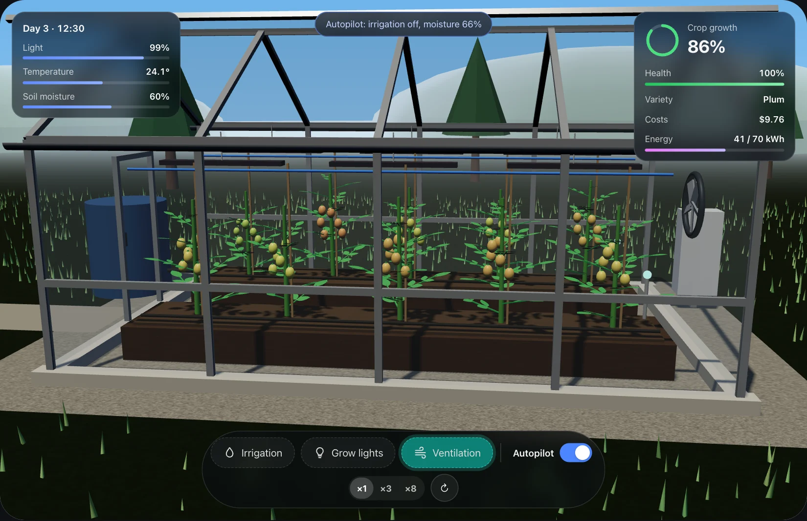
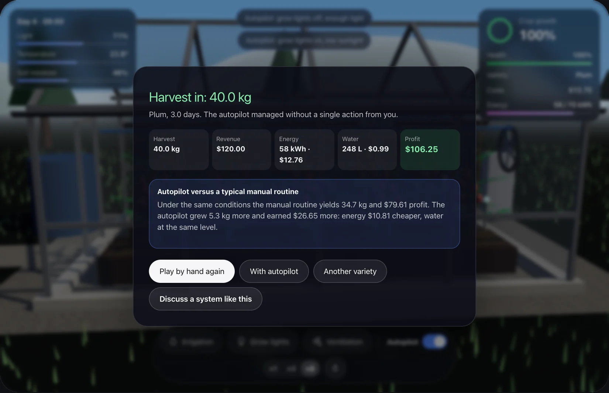

# Greenhouse game

A 3D browser game about a small tomato greenhouse. You pick a variety and take ten plants to harvest: switch irrigation, grow lights and ventilation, keep an eye on soil moisture, light and temperature, and try to stay within a 70 kWh energy budget. When the crop is ripe, the game counts harvest, costs and profit, then replays the same days with an autopilot so you can see how your result compares.

**Play:** [dimetrrius.github.io/greenhouse-game](https://dimetrrius.github.io/greenhouse-game/), or in the Lab on my studio site: [kononov.dev/en/lab/greenhouse-game](https://kononov.dev/en/lab/greenhouse-game?utm_source=github&utm_medium=open_source&utm_campaign=greenhouse_game&utm_content=readme).



## How to play

Choose a variety first. Cherry grows fast and drinks a lot. Plum is hardy and tolerates dry soil. Oxheart gives the heaviest fruit but grows slowly and suffers above 31°.

Then play by hand or start with the autopilot. You can flip the autopilot on and off at any moment, and speed time up to ×3 or ×8. At ×1 one real second is 0.6 game hours. Drag the scene to look around the greenhouse.

What hurts the plants: soil below 16% or above 94% moisture, temperature under 10° or above the variety's limit. Each stressed hour costs health, and at zero health the crop is lost. The game warns you before that happens. Grow lights help at night but draw 2.4 kW, so they use up the energy budget fast.



Prices are fixed in the code: electricity $0.22 per kWh, water with nutrients $0.004 per liter, and a per-kilogram price for each variety. Yield depends on how long the plants stayed in their comfort zone and on their average health.

## How it works

`src/engine.ts` holds both the greenhouse model and the Three.js scene. One physics function moves the greenhouse forward in time: sun, temperature, evaporation, growth and stress. The live game calls it every frame. At the end the same function runs twice more without rendering, once with the autopilot and once with a typical manual routine (big watering bursts, lamps all evening, late venting), and the end screen compares the three.

The autopilot is a handful of threshold rules: irrigation on below 45% moisture and off above 66%, lights while the sun is low between 05:00 and 21:00, ventilation above 27° (or lower for heat-sensitive varieties).

There are no models or image files to download. The greenhouse, plants, grass and trees are built from Three.js primitives, and the textures are generated on a canvas at startup. Three.js loads on demand after the page shell, and the scene renders only while it is on screen and the tab is visible. With `prefers-reduced-motion` the camera stops rotating on its own.

The interface works from the keyboard. Texts are in English, Russian, Georgian and Turkish (`?lang=en|ru|ka|tr`, otherwise the browser language). Each text is written as a Russian and English pair, and the Georgian and Turkish dictionaries in `src/i18n` are keyed by the English text.

## Run locally

Node.js 20.19 or newer.

```bash
npm install
npm run dev
```

`npm run build` type-checks and writes a static site to `dist/`. Asset paths are relative, so the build works from a domain root or a subfolder. Every push to `main` deploys it to GitHub Pages through `.github/workflows/pages.yml`.

## Stack

- **TypeScript** in strict mode for all code.
- **[Three.js](https://threejs.org) 0.170 on WebGL.** `WebGLRenderer` with soft shadows (PCF) and ACES filmic tone mapping, `OrbitControls` for the camera, `BufferGeometryUtils` to merge leaflets into one compound leaf, `InstancedMesh` for 4,200 grass blades (2,400 on phones) and the trees, `Points` for irrigation drops and stars, `MeshPhysicalMaterial` with clearcoat for the glass.
- **Canvas 2D** to generate the soil, wood, gravel and ground textures at startup.
- **[Vite](https://vite.dev) 8** for the dev server and the build. Three.js is a separate chunk loaded with a dynamic `import()`.
- **Browser APIs:** `IntersectionObserver` and the Page Visibility API to pause rendering, `ResizeObserver` for the canvas size, `prefers-reduced-motion`, `inert` for the overlays.
- **GitHub Actions and GitHub Pages** to build and publish every push to `main`.

Three.js is the only runtime dependency. No framework and no backend.

## About

My studio builds custom systems for businesses, including greenhouse and equipment automation. This game started in the Lab on [kononov.dev](https://kononov.dev/?utm_source=github&utm_medium=open_source&utm_campaign=greenhouse_game&utm_content=readme). If you want a real controller behind rules like these, with sensors and a dashboard, [write to me](https://kononov.dev/en/contact?utm_source=github&utm_medium=open_source&utm_campaign=greenhouse_game&utm_content=readme).

## License

[MIT](LICENSE), © 2026 Dmitriy Kononov.
